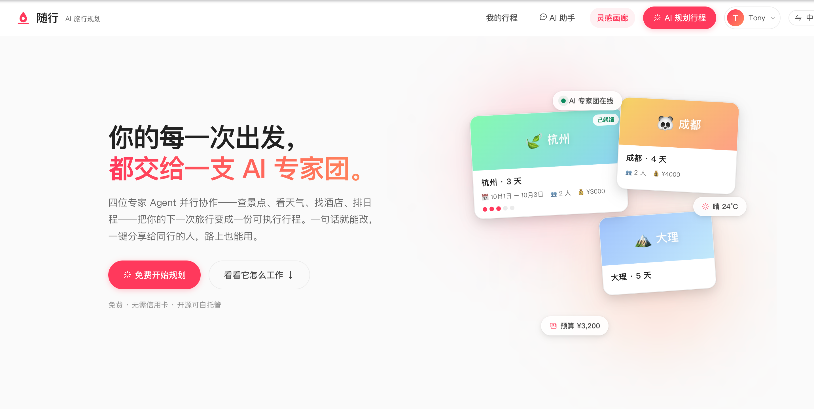
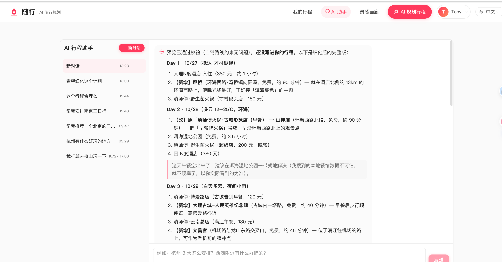
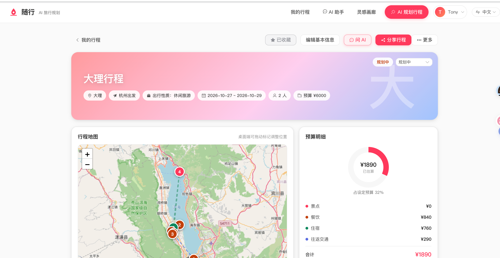
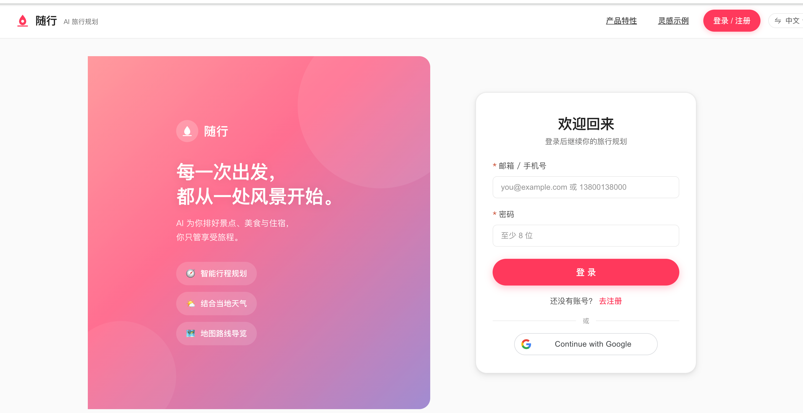
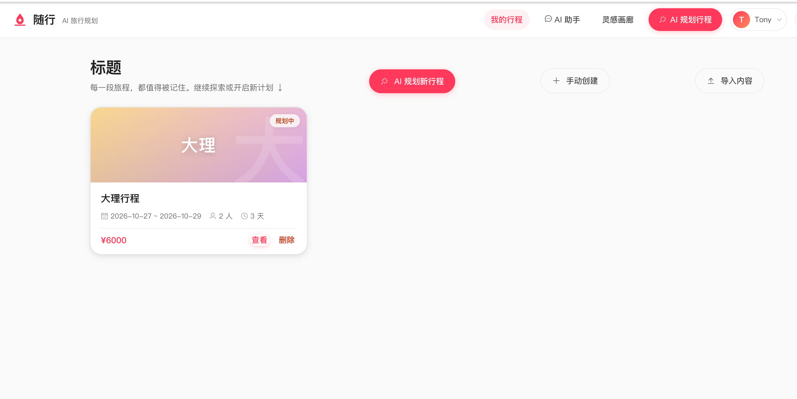
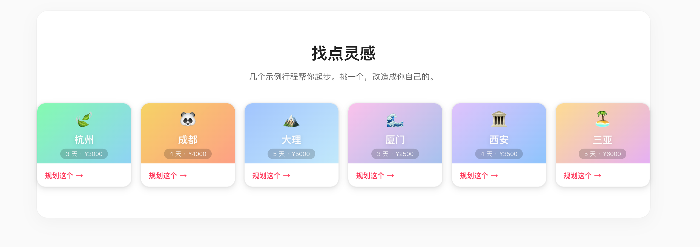
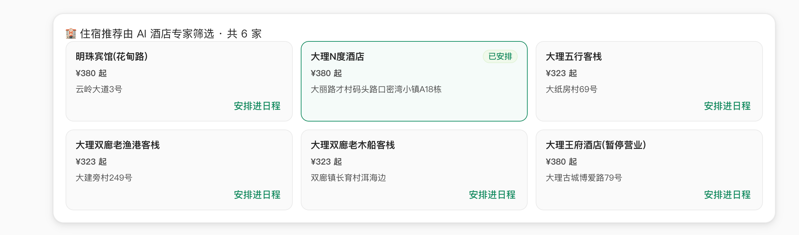
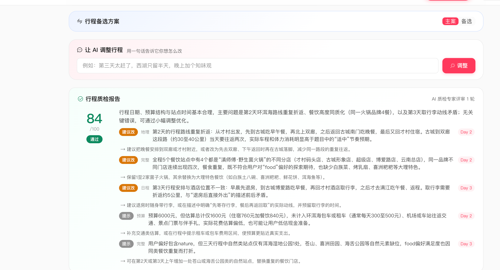
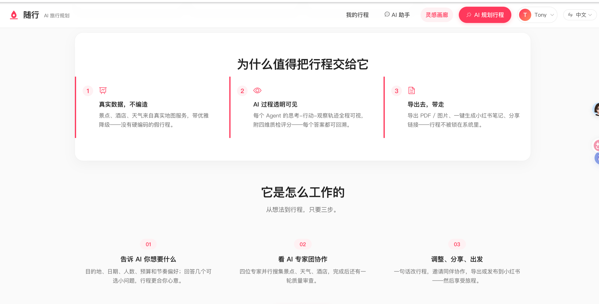
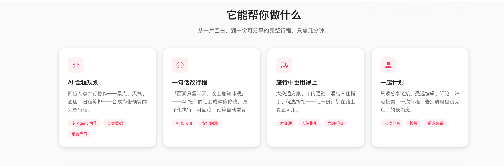

# 随行 — AI 旅行规划（my-trip-planner）

一个把 **多 Agent 协作**做成 **生产级工程** 的智能旅行应用（FastAPI + LangGraph + Vue3）。
不是"调一个 LLM 生成 JSON"的 demo —— 它回答了这类系统真正难的问题：
**怎么让多个 Agent 稳定、可靠、可测试地产出结构化业务数据。**

> 核心看点（技术向）：
> - **多 Agent 单一职责编排**：Collect 阶段 6 个采集 Agent 并行（`asyncio.gather`）+ Planner 只整合不调工具，
>   编排层代码补位（餐饮搜索、预算校准）——不是把所有逻辑塞进一个超长 prompt
> - **Evaluator-Optimizer 质检闭环**：Planner 产出后由 TravelCriticAgent（无工具质检专家）按
>   日程/预算/地理/完整性四维评分，不过审带反馈重生成（最多 2 轮后强制定稿，质检失败自动降级放行）
> - **对话式行程修订（AI 出 diff，代码执行）**：用户自然语言改行程 → PlanReviseAgent 生成结构化
>   变更指令 diff → 编排层代码原子应用（存在性/类型/位置校验，任一失败整体回滚）
> - **LLM 输出强校验 + 失败自纠正**：所有 Agent 最终输出过 Pydantic Schema（字段/类型/日期/预算范围），
>   校验失败把错误摘要喂回 LLM 最多自纠正 3 次——LLM 输出不可信，schema 才可信
> - **系统级容错**：LLM 调用统一指数退避重试 + 进程内熔断器（滑动窗口），保护下游 LLM 不被打爆
> - **真实数据，不造假**：高德 POI/天气（未配置自动降级 Tavily + wttr.in），没有硬编码假数据
> - **可测试性当一等公民**：FakeLLM 测试替身让 **453 个测试**不耗 token、不依赖网络
> - **全链路可观测**：异步规划任务 + 前端实时 T-A-O（Thought-Action-Observation）轨迹

## 界面速览

从一片空白，到一份可分享的完整行程，只需几分钟：

| 首页 | AI 助手（规划 / 修订） | 行程详情 |
|---|---|---|
| 城市模板 + 示例行程，一键开始规划 | 自然语言对话：规划、细化、一句话改行程 | 预算明细 + 行程地图 + 日程编排 |
|  |  |  |

| 登录 / 注册 | 我的行程 | 灵感画廊 |
|---|---|---|
| 邮箱/手机号 + Google 登录 | 行程管理与导入入口 | 城市模板 + 示例行程，改造即用 |
|  |  |  |

| 酒店推荐 | AI 质检 + 备选方案 | 首页亮点区 |
|---|---|---|
| AI 酒店专家筛选，可直接安排进日程 | 质检专家逐日评审 + 确定性 Plan B 对照 | 价值主张与三步工作流介绍 |
|  |  |  |

首页完整价值主张区：



> 还有更多：一句话改行程（`AI 出 diff`）、自驾校验、打包清单、协作投票、行程事件流、小红书笔记生成。
> 前端为桌面 Web 设计，支持中/英双语（vue-i18n 643+ 键）。

## 核心功能

### 🧩 多 Agent 智能规划

用户输入目的地、日期、偏好，**多位角色 Agent 协作**生成完整行程：
- **AttractionSearchAgent**（景点搜索专家）→ **WeatherQueryAgent**（天气查询专家）→
  **HotelAgent**（酒店推荐专家）→ **FoodAgent**（餐饮专家）→ **TransportAgent**（大交通）、**DiscountAgent**（折扣规则），
  最后由 **PlannerAgent**（行程规划专家）统一整合。
- **单一职责提示词**：每个搜索 Agent 只做一件事——理解偏好/需求 → 选关键词 → 调工具；
  PlannerAgent 不调用工具，只整合团队产出，输出经 Pydantic 强校验的行程 JSON（失败自动自纠正）。


### ☀️ 真实数据搜索

- 景点/酒店/餐厅用**高德地图 POI**（`AMAP_API_KEY`），天气用**高德天气**；
  未配置高德 key 时自动降级 Tavily Search + Nominatim / wttr.in——没有硬编码假数据。
- **并行编排**：三个采集 Agent 并行执行（`asyncio.gather`），快且互不阻塞；
  编排层补充餐饮，Planner 最后统一整合，预算按真实站点费用代码校准。

### ⚙️ 异步规划任务 + T-A-O 轨迹

规划提交后立即返回 `task_id`，前端轮询/WebSocket 实时展示多 Agent 的
Thought-Action-Observation 轨迹（含 agent 名）。

### ✅ LLM 输出强校验

所有 Agent 最终行程 JSON 都经过 Pydantic Schema 校验（字段/类型/日期/预算），
失败自动让 LLM 自纠正（最多 3 次）。

### 🔍 行程质检（Evaluator-Optimizer）

Planner 产出后由 `TravelCriticAgent` 从日程/预算/地理/完整性四维审查，
不过审把结构化 issues 反馈给 Planner 重生成，最多 `AGENT_MAX_REVIEW_ROUNDS`（默认 2）轮后强制定稿；
质检自身失败自动降级「通过放行」，绝不阻断主流程。


### 🏨 酒店推荐

`HotelAgent` 按住宿需求（经济型/豪华型/亲子…）筛选真实酒店 POI，展示价格与位置，可直接安排进日程。


### ✍️ 对话式行程修订（AI 出 diff，代码执行）

`POST /trips/{id}/revise` 用一句话改行程——`PlanReviseAgent` 把用户请求解析为
结构化 diff（replace/add/remove/reorder），编排层代码**原子应用**（目标/类型/位置校验，任一失败整体回滚，
数据库事务不提交），预算由代码重算，前端详情页「让 AI 调整行程」直接对话操作。

> 「第三天太赶了，西湖只留半天」→ AI 精确改好 → 预算重算 → 可回滚。

### 🗺️ 地图拖拽修订

`POST /trips/{id}/map-edit` 拖动地图 marker 改坐标 → 最小 diff 原子应用（复用 revise 原子内核，受 DrivingGate 约束）。

### 🚗 自驾模式校验（DrivingGate）

同一天相邻站点单段驾车距离/时长上限（120km / 150min）与单日累计里程上限（300km）确定性校验，
超限标记 critical 反馈 Planner 带问题重生成；对话式修订同样受该门约束。

### 📋 预算计算

按站点类型（景点/餐饮/住宿）自动汇总预算明细，含大交通往返估算与酒店城市基准价。

### 🧳 手动细粒度编辑

- 站点行内编辑（PATCH）+ 整日站点顺序重排（PUT，幂等），与 AI 对话式修订并存、互不覆盖。

### 👥 轻量多用户隔离

前端自动生成用户 token 随请求头发送，行程与任务按用户隔离。

### 🔗 行程分享与多人协作

- `share_token` 免登录只读分享链接（含预算汇总，幂等复用）；
- 分享页支持评论 + 每日站点 👍/👎 投票；
- `edit_token` 受邀编辑权与只读分享分离——受邀者免登录受限编辑（站点名称/备注/勾选/顺序），owner 可随时收回；
- **分享令牌生命周期管理**：TTL（`/share/ttl`）、吊销（`/share/revoke`）、使用审计（`/share/lifecycle`），
  过期令牌返回 410、吊销返回 403；
- **收藏灵感夹**：登录用户可将他人分享的行程收藏进自己的灵感夹（`/trips/favorites`）。

### 💡 主动提问 + 用户画像记忆

- 规划请求可携带 Questions Q&A（人群/节奏/避峰/备选方案），答案并入规划上下文；
- 跨会话用户画像（GET/PUT `/profile`）自动注入规划上下文。

### 🔐 Google 登录 + 多语言

Google ID Token 登录（`POST /auth/google`，前端 `VITE_GOOGLE_CLIENT_ID` 留空则隐藏按钮）；
vue-i18n 9 + zh-CN/en-US + 顶栏切换器 + Element Plus locale 联动（643+ i18n 键）。


### 📥 攻略/截图/链接/邮件导入（OCR + 分享链接）

- 上传小红书截图 → macOS Vision OCR → 站点候选；
- 粘贴社交分享链接（小红书/马蜂窝/携程/大众点评等）→ 提取结构化信息（失败静默降级为链接收藏）；
- 邮件转发导入；统一走 `note-import` 管线（敌意输入剥离、类型/价格/时长推断）。

### 🔄 确定性 Plan B 备选方案

`GET /trips/{id}/plan-b` 基于规则引擎生成另一套行程（无 LLM 成本、毫秒返回），与 AI 方案对照选择。

### 🛰️ 实时候车 WebSocket

规划任务 T-A-O 轨迹流式推送（`/ws/planner/tasks/{task_id}`，断线由轮询兜底）+
行程协作实时同步（`/ws/trips/{trip_id}/collab`，评论/投票/受邀编辑增量事件广播，免登录令牌鉴权）。

### 🧭 定稿后服务（servicing 阶段）

行程定稿后可兑现的服务层产物——市内通勤视图（相邻站点公共交通/步行/驾车建议）、
酒店入住办理指引（模板基座 + LLM 润色，不收集证件号）、折扣规则（确定性本地规则库，零幻觉可审计）；
三个子任务相互独立，任一失败不影响其他，全程失败降级不阻断主流程。

### 📕 小红书笔记生成

`POST /trips/{id}/xhs-note` 为行程生成适配小红书发布的种草笔记（标题/正文/话题），
LLM 主路径 + 规则模板兜底（`source` 标注 llm/template），发布由用户复制到小红书 App 完成，接口无自动发布副作用。

### ⏰ 营业时间/游玩时长校验（TimeGate）

POI 类目基准营业时段 + 建议游玩时长规则库（零外部依赖、无 LLM），排程校验
「闭馆到达（<30min 缓冲）」「单日过饱和（>5 站或 >480 分钟游玩）」，产出 warning + 调整建议，
注入 `plan.time_gate` 供前端质检卡展示；对话式修订后同步重算；真实营业时间以 POI 现场为准（`basis=rule_based` 诚实标注）。

### 🏃 体力负荷提示

`EXERTION_BY_TYPE` 体力系数表 + 名称关键词规则库（登山/徒步/雪山/峡谷等），
单日体力负荷累计超限 + 高强度站点「实际耗时可能显著上浮」提示，复用质检卡通道（`basis=rule_based`）。

### 📅 动态事实校验

行程日期 × POI 特例规则表（周一闭馆 / 每月免费日 / 节假日窗口），命中即 warning +
「出行前再次确认」诚实标注（`dynamic_facts.py`，零凭证路线）。

### 🔔 行程事件流 + 主动通知

修订/打卡/跳过/顺延/评论/投票 append-only 记录到 `trip_events`，owner 与受邀者（share/edit token 免登录）可读事件流；
前端未读红点 + PWA Notification（`event_service.py` + `TripEventFeed.vue`）。

### 🏙️ 多城市衔接

`cities` 有序城市列表 → 按天数分段排程 + 段间插入交通占位站（球面距离按均速估算）+ 衔接缓冲校验 warning（`multi_city.py`）。

### 🎨 公开灵感画廊 + 城市模板

owner 一键把已分享行程发布到精选（目的地/天数/预算/一句话卖点），访客「以此为基础创建」复制到自己的账号；
城市模板由 23 目的地知识库规则生成深链预填（`gallery_service.py`）。


### 🎒 打包清单

按行程隔离的本地打包清单（5 套预设模板 + 自定义 + 勾选进度 + 清除已完成，纯前端零凭证）。

### 💬 AI 助手（随行对话）

侧边栏常驻 AI 助手，可全程自然语言对话：行程问答、一句话改行程、细化/调整建议，
回复实时流式展示（AgentLoop）。与行程详情页修订共用同一个原子修订内核。

## 技术栈

- **FastAPI** — Web 框架，自动生成 OpenAPI 文档（`/docs`）
- **LangGraph / LangChain** — Agent 状态图与工具编排（多 Agent 流水线；编排核心收敛在 `app/agent/pipeline.py` 4 个 PipelineStep，LangGraph 原型保留于 `app/agent/graph.py`）
- **PostgreSQL 17** — 数据库（Docker 部署）
- **SQLAlchemy 2 (async) + asyncpg** — ORM 与异步驱动
- **Alembic** — 数据库迁移
- **Pydantic v2 + pydantic-settings** — 数据校验与配置管理
- **高德开放平台（POI / 天气）+ Tavily + wttr.in** — 真实数据源
- **Vue3 + Vite + Element Plus + Leaflet + vue-i18n + Pinia** — 前端
- **pytest + httpx** — 测试（FakeLLM 测试替身，不消耗 token、不依赖网络）

## 目录结构

```
my-trip-planner/
├── img/                      # README 截图（首页/登录/详情/酒店/质检/画廊等）
├── backend/
│   ├── app/
│   │   ├── main.py           # FastAPI 应用工厂（lifespan 启动规划执行器 + AgentLoop）
│   │   ├── run_server.py     # uvicorn 启动入口
│   │   ├── common/config.py  # pydantic-settings 配置
│   │   ├── core/             # logging / tracing / exceptions / database / auth
│   │   ├── models/           # SQLAlchemy ORM（Trip/Day/Stop/Plan/PlanTask/Profile/Chat/评论/投票/事件）
│   │   ├── schemas/          # Pydantic 请求/响应模型 + Agent 输出强校验 + AgentLoop 协议
│   │   ├── services/         # 业务逻辑（trip/budget/planning/revise/collab/driving/profile/auth/google/event/servicing/multi_city/chat/expense/...）
│   │   ├── agent/            # 多 Agent 编排：
│   │   │   ├── pipeline.py   #   PipelineStep（Collect→Assemble→Finalize→Servicing 四步）
│   │   │   ├── agents.py     #   Agent 定义 + 编排主流程（采集六路并行 + Planner + Critic）
│   │   │   ├── runtime.py    #   通用 AgentLoop（turn/事件流/工具编排/终止护栏/校验重试）
│   │   │   ├── tools.py      #   高德·Tavily·天气/工具
│   │   │   └── providers.py  #   LLM 提供商（deepseek/openai/ollama + 重试/熔断/兜底）
│   │   └── api/v1/           # 路由（health/auth/trips/planner/profile/chat/share/ws/import/export/...）
│   ├── alembic/              # 数据库迁移
│   ├── tests/                # pytest 测试（453 个：FakeLLM 替身，覆盖协作/自驾/画像/编辑/恢复/时间校验/事件流/多城市/画廊等）
│   ├── pyproject.toml        # uv 工程配置
│   ├── .env / .env.example   # 环境变量
│   └── uv.lock
└── frontend/                 # Vue3 + Vite + Element Plus + Leaflet + vue-i18n
    └── src/views/            #   LandingPage / AuthView / PlanWizard / TripListView / TripDetailView / ChatView / ShareView / ...
```

## 快速启动

### 1. 数据库（Docker）

```bash
docker run -d --name postgres -p 5432:5432 \
  -e POSTGRES_PASSWORD=your_password \
  -v pgdata:/var/lib/postgresql/data \
  postgres:17

docker exec -it postgres psql -U postgres -c \
  "CREATE DATABASE my_trip_planner;"
```

### 2. 配置环境变量

```bash
cp .env.example .env
# 必填：
#   DATABASE_URL         数据库连接串
#   TAVILY_API_KEY       Tavily 搜索 key（https://tavily.com）
#   DEEPSEEK_API_KEY 或 OPENAI_API_KEY（或本地 Ollama）
# 可选：
#   DEFAULT_LLM_PROVIDER auto/deepseek/openai/ollama
```

### 3. 安装依赖并迁移

```bash
uv sync                 # 安装依赖
uv run alembic upgrade head   # 应用数据库迁移
```

### 4. 启动服务

```bash
uv run python app/run_server.py
# 或
uv run uvicorn app.main:app --reload
```

访问 http://127.0.0.1:8090/docs 查看 API 文档。

前端：

```bash
cd frontend && npm install && npm run dev   # http://localhost:5173
```

## 环境变量

| 变量 | 说明 | 默认 |
|---|---|---|
| `ENV` | 运行环境（dev/staging/prod） | `dev` |
| `HOST` / `PORT` | 服务监听地址/端口 | `127.0.0.1` / `8090` |
| `DATABASE_URL` | 数据库连接串（asyncpg） | 必填 |
| `DEFAULT_LLM_PROVIDER` | 模型提供商（auto/deepseek/openai/ollama） | `auto` |
| `DEEPSEEK_API_KEY` | DeepSeek key | 空 |
| `OPENAI_API_KEY` / `OPENAI_BASE_URL` / `OPENAI_MODEL` | OpenAI 兼容接口 | 空 / `gpt-4o-mini` |
| `OLLAMA_BASE_URL` / `OLLAMA_MODEL` | 本地 Ollama（`OLLAMA_MODEL` 必须与本机 `ollama list` 的实际模型名一致） | `http://localhost:11434` / `batiai/gemma4-12b:q4` |
| `TAVILY_API_KEY` | Tavily 搜索 key（高德未配置时降级源） | 空 |
| `AMAP_API_KEY` | 高德开放平台 Web 服务 key（POI 搜索/天气，https://lbs.amap.com 申请） | 空 |
| `GOOGLE_CLIENT_ID` / `GOOGLE_CLIENT_SECRET` | Google OAuth（ID Token 登录用 Client ID 校验） | 空 |
| `AGENT_MAX_ITERATIONS` | Agent 最大循环次数 | `10` |
| `AGENT_MAX_CORRECTIONS` | LLM 输出校验失败的最大自纠正次数 | `3` |
| `AGENT_MAX_REVIEW_ROUNDS` | 行程质检（Critic）最大评审轮数，过后强制定稿 | `2` |
| `LLM_MAX_RETRIES` / `LLM_RETRY_BASE_DELAY` / `LLM_RETRY_MAX_DELAY` | LLM 指数退避重试（次数/初始/上限秒） | `3` / `0.5` / `8.0` |
| `LLM_BREAKER_FAILURE_THRESHOLD` / `LLM_BREAKER_RECOVERY_TIMEOUT` | LLM 熔断阈值与冷却秒数 | `3` / `30.0` |
| `LLM_INPUT_PRICE_PER_1K` / `LLM_OUTPUT_PRICE_PER_1K` | 每次调用成本估算（USD/1K tokens），配置后写入 trace | 空 |
| `TASK_EXECUTION_TIMEOUT` / `TASK_STALE_RUNNING_SECONDS` / `TASK_PENDING_STALE_SECONDS` | 任务执行超时秒数 / 启动恢复扫描（running 崩溃遗留 / pending 卡死标记失败） | `180` / `300` / `300` |
| `ENABLE_PROVIDER_FALLBACK` | 主 LLM provider 失败后自动切换兜底（deepseek → openai → ollama） | `true` |
| `LOG_LEVEL` | 日志级别 | `DEBUG` |
| `JWT_SECRET` | JWT 签名密钥（**生产必配**；缺失时非 dev 环境启动直接失败，避免重启后全员登出） | 进程级随机（仅 dev） |
| `JWT_EXPIRE_MINUTES` | token 有效期（分钟） | `10080`（7 天） |
| `CORS_ORIGINS` | 允许的跨域来源 | `*` |

> 前端另有 `.env.local`（参考 `frontend/.env.example`）：`VITE_GOOGLE_CLIENT_ID` 留空时隐藏 Google 登录按钮。

## API 一览

| 方法 | 路径 | 说明 |
|---|---|---|
| POST | `/api/v1/auth/register` | 注册（邮箱或手机号 + 密码） |
| POST | `/api/v1/auth/login` | 登录（邮箱或手机号 + 密码），返回 JWT |
| POST | `/api/v1/auth/google` | Google 登录（ID Token） |
| GET | `/api/v1/auth/me` | 当前用户信息（需登录） |
| GET | `/api/v1/health` | 健康检查（含数据库连通性/延迟，DB 故障返回 degraded 而非 500） |
| GET | `/api/v1/profile` | 当前用户画像（无画像返回空默认） |
| PUT | `/api/v1/profile` | 保存画像（全量 upsert；规划时自动注入画像摘要） |
| GET | `/api/v1/trips` | 行程列表（分页，按用户隔离） |
| POST | `/api/v1/trips` | 创建行程 |
| GET | `/api/v1/trips/{id}` | 行程详情 |
| PATCH | `/api/v1/trips/{id}` | 更新行程 |
| DELETE | `/api/v1/trips/{id}` | 删除行程 |
| POST | `/api/v1/trips/{id}/days` | 添加日程 |
| POST | `/api/v1/trips/{id}/days/generate` | 按日期范围批量生成日程 |
| POST | `/api/v1/trips/days/{day_id}/stops` | 添加站点 |
| PATCH | `/api/v1/trips/days/{day_id}/stops/{stop_id}` | 编辑站点（手动细粒度编辑，仅更新传入字段） |
| PUT | `/api/v1/trips/days/{day_id}/stops/order` | 重排整日站点顺序（幂等） |
| DELETE | `/api/v1/trips/days/{day_id}` | 删除日程（级联站点） |
| DELETE | `/api/v1/trips/days/{day_id}/stops/{stop_id}` | 删除站点 |
| GET | `/api/v1/trips/{id}/budget` | 预算明细（含酒店城市基准价估算） |
| GET | `/api/v1/trips/{id}/plan` | 行程完整方案（Agent 输出快照，含酒店推荐） |
| POST | `/api/v1/trips/{id}/revise` | **对话式修订行程（AI 出 diff，代码原子执行）** |
| POST | `/api/v1/trips/{id}/map-edit` | **地图拖拽修订（复用 revise 原子内核）** |
| POST | `/api/v1/trips/{id}/share` | 生成只读分享链接（幂等复用） |
| GET | `/api/v1/trips/share/{token}` | 按分享令牌免登录只读查看（含预算汇总） |
| GET | `/api/v1/trips/share/{token}/comments` | 分享页评论列表（免登录） |
| POST | `/api/v1/trips/share/{token}/comments` | 分享页发表评论（免登录，昵称可选） |
| GET | `/api/v1/trips/share/{token}/votes` | 分享页站点投票汇总（免登录） |
| POST | `/api/v1/trips/share/{token}/votes/{stop_id}` | 站点投票/翻转（免登录，幂等） |
| POST | `/api/v1/trips/{id}/share/edit` | 开放受邀编辑权（生成 edit link） |
| DELETE | `/api/v1/trips/{id}/share/edit` | 收回受邀编辑权（已有链接立即失效） |
| GET | `/api/v1/trips/edit/{token}` | 按编辑令牌查看行程（含预算汇总） |
| PATCH | `/api/v1/trips/edit/{token}/stops/{stop_id}` | 受邀者编辑站点受限字段（名称/备注/勾选） |
| PUT | `/api/v1/trips/edit/{token}/days/{day_id}/stops/order` | 受邀者重排整日站点顺序 |
| POST | `/api/v1/planner/plan` | **提交 AI 规划任务（异步，需登录；支持 questions 主动提问）** |
| GET | `/api/v1/planner/tasks/{task_id}` | **轮询规划任务状态（含实时 trace，需登录）** |
| POST | `/api/v1/chat/sessions` | 创建 AI 助手会话 |
| GET | `/api/v1/chat/sessions` | 列出我的会话 |
| GET | `/api/v1/chat/sessions/{session_id}` | 会话详情 |
| DELETE | `/api/v1/chat/sessions/{session_id}` | 删除会话 |
| GET | `/api/v1/chat/sessions/{session_id}/messages` | 会话历史消息 |
| POST | `/api/v1/chat/sessions/{session_id}/messages` | 发送消息并获取回复 |
| POST | `/api/v1/trips/{id}/xhs-note` | 生成小红书笔记（标题/正文/话题） |
| GET | `/api/v1/trips/{id}/plan-b` | 生成确定性 Plan B 备选方案 |
| POST | `/api/v1/trips/{id}/gallery/publish` | 发布行程到灵感画廊（owner） |
| DELETE | `/api/v1/trips/{id}/gallery/publish` | 取消发布（owner） |
| GET | `/api/v1/gallery` | 公开灵感画廊（已发布行程摘要，免登录） |
| GET | `/api/v1/gallery/templates` | 城市模板卡（23 目的地知识库，免登录） |
| POST | `/api/v1/gallery/{source_id}/clone` | 以画廊行程为基础创建副本（复制到自己账号） |
| GET | `/api/v1/trips/favorites` | 我的收藏灵感夹 |
| POST | `/api/v1/trips/favorites` | 收藏他人分享的行程 |
| DELETE | `/api/v1/trips/favorites` | 取消收藏 |
| GET | `/api/v1/trips/{id}/events` | 行程事件流（owner + 受邀者） |
| POST | `/api/v1/trips/email/import` | 邮件转发导入（粘贴预订确认邮件 → 预订条目 + 站点候选） |
| POST | `/api/v1/trips/screenshot/import` | 上传截图 → OCR → 站点候选 |
| POST | `/api/v1/trips/link/import` | 粘贴分享链接 → 结构化信息 |
| POST | `/api/v1/trips/note/import` | 文本笔记导入站点候选 |
| GET | `/api/v1/expenses` | 支出记录列表 |
| POST | `/api/v1/expenses` | 添加支出记录 |
| DELETE | `/api/v1/expenses` | 删除支出记录 |
| GET | `/api/v1/trips/{trip_id}/export` | 导出行程 JSON（owner，完整数据备份） |
| GET | `/api/v1/trips/share/{token}/export` | 导出行程 JSON（免登录，凭 share_token 只读） |
| GET | `/api/v1/trips/share/{token}/live` | 行中「今日视图」快照（免登录只读，凭 share_token） |
| GET | `/api/v1/trips/{trip_id}/live` | 行中「今日视图」快照（owner，归一化阶段/今日站点/打卡进度） |
| POST | `/api/v1/trips/{trip_id}/live/stops/{stop_id}/check` | 打卡/取消打卡（owner 行中） |
| POST | `/api/v1/trips/{trip_id}/live/stops/{stop_id}/skip` | 跳过今日站点（owner 行中） |
| POST | `/api/v1/trips/{trip_id}/live/delay` | 迟到一键顺延（owner，今日及之后整体后移一天） |
| POST | `/api/v1/trips/{trip_id}/share/ttl` | 设置分享/受邀编辑令牌有效期（days=0 永久） |
| POST | `/api/v1/trips/{trip_id}/share/revoke` | 吊销分享/受邀编辑令牌（幂等，链接立即失效） |
| GET | `/api/v1/trips/{trip_id}/share/lifecycle` | 分享/受邀编辑令牌生命周期状态（owner，含最近使用审计） |
| POST | `/api/v1/trips/edit/{token}/live/stops/{stop_id}/check` | 打卡/取消打卡（受邀者，免登录） |
| POST | `/api/v1/trips/edit/{token}/live/stops/{stop_id}/skip` | 跳过今日站点（受邀者，免登录） |
| POST | `/api/v1/trips/edit/{token}/live/delay` | 迟到一键顺延（受邀者，免登录） |
| WS | `/ws/planner/tasks/{task_id}` | 规划任务 T-A-O 实时轨迹 |
| WS | `/ws/trips/{trip_id}/collab` | 行程协作实时同步（评论/投票/编辑） |

> 除 `/auth/*`、`/health`、`/gallery`、分享令牌（`/share/*`、`/edit/*`）与灵感画廊外，多数接口需要 `Authorization: Bearer ***`

### 注册 / 登录示例

```bash
# 注册（邮箱或手机号至少一个）
curl -X POST http://127.0.0.1:8090/api/v1/auth/register \
  -H "Content-Type: application/json" \
  -d '{"email": "you@example.com", "password": "your_password", "display_name": "小明"}'
# → { "access_token": "eyJ...", "token_type": "bearer", "user": {...} }

# 登录
curl -X POST http://127.0.0.1:8090/api/v1/auth/login \
  -H "Content-Type: application/json" \
  -d '{"account": "you@example.com", "password": "your_password"}'

# 用 token 访问受保护接口
curl http://127.0.0.1:8090/api/v1/trips \
  -H "Authorization: Bearer ***"
```

### 调用 Agent 规划行程（异步）

```bash
# 先登录获取 token
TOKEN=$(curl -s -X POST http://127.0.0.1:8090/api/v1/auth/login \
  -H "Content-Type: application/json" \
  -d '{"account": "you@example.com", "password": "your_password"}' | python3 -c "import sys,json;print(json.load(sys.stdin)['access_token'])")

curl -X POST http://127.0.0.1:8090/api/v1/planner/plan \
  -H "Content-Type: application/json" \
  -H "Authorization: Bearer ***" \
  -d '{
    "destination": "杭州",
    "start_date": "2026-10-01",
    "end_date": "2026-10-03",
    "travelers": 2,
    "budget": 3000,
    "preferences": ["美食", "自然"],
    "questions": [
      {"question": "出行人群？", "options": ["情侣", "亲子", "朋友"], "answer": "情侣"},
      {"question": "节奏偏好？", "answer": "松弛，一天 2-3 个点"}
    ]
  }'

# → { "task_id": "xxx", "status": "pending", ... }

curl http://127.0.0.1:8090/api/v1/planner/tasks/xxx \
  -H "Authorization: Bearer ***"
# → { "task_id": "xxx", "status": "completed", "trip_id": "...", "plan": {...}, "trace": [...] }
```

## 多 Agent 架构

### 编排流水线（Collect → Assemble → Finalize → Servicing）

`app/agent/pipeline.py` 用**声明式 PipelineStep** 收敛编排：新增一步只需注册一个步骤。
四个阶段（前两段为当前迁移主战场）：

```
用户输入（目的地/日期/人数/预算/偏好/画像/questions）
                    │
                    ▼
┌───────────────────────────────────────────────────────────────┐
│ ① CollectAgentsStep —— 采集（六路并行 asyncio.gather）          │
│   AttractionSearchAgent  景点搜索专家（偏好→关键词→POI）        │
│   WeatherQueryAgent      天气查询专家（纯工具·确定性路径）       │
│   HotelAgent             酒店推荐专家（需求→关键词→POI）        │
│   FoodAgent              餐饮专家（美食必备，失败编排层降级补位） │
│   TransportAgent         大交通参考（往返价并入预算）            │
│   DiscountAgent          折扣规则（确定性规则库·零幻觉）         │
│   —— 单 agent 失败不整体抛错（return_exceptions，产物标记 failed）│
└───────────────────────────────────────────────────────────────┘
                    │
                    ▼
┌───────────────────────────────────────────────────────────────┐
│ ② PlanAssembleStep —— Planner + 评审循环 + DrivingGate         │
│   PlannerAgent（不调用工具，只整合团队产出）                    │
│     → 预算校准 compute_budget（代码覆盖 LLM 估值）              │
│     → DrivingGate 自驾校验（未过 → 带自驾反馈重生成，不进 Critic）│
│     → TravelCriticAgent 四维质检（schedule/budget/geography/   │
│       logistics；未过 → 优先 Critic fix（站点级精确修订），     │
│       fix 失败回退整段重生成；达 max_review_rounds 强制定稿）   │
└───────────────────────────────────────────────────────────────┘
                    │
                    ▼
┌───────────────────────────────────────────────────────────────┐
│ ③ FinalizePlanStep —— 定稿回填 + 门控（全部只报告不阻断）        │
│   采集产物回填（transport/discount_rules/driving 报告）          │
│   MultiCity 多城市分段 + 段间交通占位                           │
│   TimeGate 营业时间/游玩时长校验 → plan.time_gate               │
│   DynamicFacts 日期特例（周一闭馆/免费日/节假日） → warnings     │
└───────────────────────────────────────────────────────────────┘
                    │
                    ▼
┌───────────────────────────────────────────────────────────────┐
│ ④ ServicingStep —— 定稿后服务（三个子任务独立，失败只记 warning）│
│   市内通勤视图（相邻站点公交/步行/驾车建议）                    │
│   酒店入住办理指引（模板基座 + LLM 润色，不收集证件号）          │
│   折扣规则（确定性本地规则库，零幻觉可审计）                    │
└───────────────────────────────────────────────────────────────┘
                    │
                    ▼
              完整行程 JSON（落库）+ T-A-O trace 流式推送
```

**为什么这样拆**（而不是一个超长 prompt 大杂烩）：
- **单一职责**：每个 Agent 只做一件事，提示词极简（< 30 行），行为可预期
- **并行**：六个采集 Agent 互不依赖，`asyncio.gather` 秒级完成，单 agent 失败可降级
- **确定性兜底**：天气是"城市→数据"的确定性路径，干脆做成纯工具（零 token、零幻觉）；
  预算是纯计算，交给 `compute_budget` 代码——**LLM 只做它擅长的"理解 + 编排"，数学和事实交给代码**
- **编排层补位**：Agent 不会主动想起"还要吃顿饭"，编排层用代码补上餐饮——不依赖 prompt 自觉
- **质检用独立角色**：Evaluator（Critic）与 Generator（Planner）是不同的 system prompt + 独立调用，
  避免共享盲点——生成者不会自己审自己的错
- **修订"AI 出题、代码执行"**：PlanReviseAgent 只产 diff 指令，落库由代码原子应用——
  任一动作非法就整体回滚，杜绝 LLM 直接改库带来的半生效状态

### 修订链路（方案 B：对话改行程）

```
用户：一句话修改请求（如「第三天太赶了，西湖只留半天」）
                    │
                    ▼
        ┌─────────────────────────┐
        │   PlanReviseAgent       │
        │  · 用户消息 + 当前行程 →  │
        │    结构化 diff 指令      │
        │  · 输出经 ReviseDiff     │
        │    强校验 + 自纠正       │
        └─────────────────────────┘
                    │  diff（replace / add / remove / reorder）
                    ▼
        ┌─────────────────────────┐
        │  编排层代码（原子应用）    │
        │  · 预检全部动作（目标/    │
        │    类型/位置）            │
        │  · 任一失败 → 整体回滚    │
        │  · 预算由代码重算         │
        └─────────────────────────┘
                    │
                    ▼
            新行程落库 + 变更摘要
```

## Agent 运行时（AgentLoop）

`app/agent/runtime.py` 提供通用 Agent 循环（移植 pi-agent-core 设计理念，Python 重写）：

```
用户请求
   │
   ▼
┌─► agent_start → turn_start → message_start/update/end
│     │
│     ├── 需要信息？ ──► tool_execution_start/end（执行真实工具）
│     │                        │
│     │                        ▼
│     └── 信息足够？      Observation 回填 ──┐
│                                          │
└──► turn_end → validator 校验通过？ → agent_end（输出最终行程 JSON）
         │失败
         ▼
   反馈 LLM 自纠正（最多 AGENT_MAX_CORRECTIONS 次）
```

- **事件流**：`agent_start → turn_start → message_start/update/end → tool_execution_start/end → turn_end → (validator 失败 → 反馈重试) → agent_end`，兼容 WS 增量推送
- **护栏（防无限循环）**：`max_iterations` 全局迭代上限（含工具轮 + 校验重生成轮）+
  `max_corrections` validator 失败反馈重试上限 + `should_stop_after_turn` / tool `terminate` 提前结束信号
- **截断保护**：输出 token 截断（stop_reason=length）→ 工具参数可能被截断 → 一律按 `is_error` 拒绝执行
- **LLM 统一调用**：`invoke_with_resilience`（保留重试/熔断/兜底/结构化观测）

**LLM Provider**：配置 `DEEPSEEK_API_KEY` / `OPENAI_API_KEY`（或本地 Ollama）后即可使用真实模型。
未配置任何 key 时，`/planner/plan` 返回明确错误（**不再有 mock 降级**）。

## 质量与兜底（Quality & Fallback）

OTA 用真人兜底（携程人工定制师、马蜂窝当地指路人）——开源自托管工具没有人肉兜底，这是客观短板；
但我们的「兜底」是**工程化的降级链 + 可回溯的质检 trace**：坏答案比没答案更危险，所以每一层都设计了
「失败时往哪退、退到什么」的显式路径，且每一步都有结构化日志可查。

**LLM 调用降级链（主路径 → 兜底 → 结构化降级响应）**：

1. **指数退避重试**：瞬时故障（网络/超时/限流/5xx）按 `LLM_MAX_RETRIES`（默认 3）指数退避重试；
2. **进程内熔断器**：滑动窗口统计失败率（`LLM_BREAKER_FAILURE_THRESHOLD` / `LLM_BREAKER_RECOVERY_TIMEOUT`），
   连续失败跳闸 OPEN，冷却期后 HALF-OPEN 试探恢复——保护下游 LLM 不被打爆；
3. **Provider 兜底链**：`ENABLE_PROVIDER_FALLBACK=true` 时主 provider（如 deepseek）失败自动切换
   openai → ollama（`app/agent/providers.py::_fallback_chain_for`）；
4. **采集源降级**：高德未配置时 POI/天气自动降级 Tavily + wttr.in（`app/agent/tools.py`，无 key 也能跑）；
5. **质检（Critic）失败降级放行**：`TravelCriticAgent` 自身抛错或校验失败 → 构造「通过」的默认质检报告
   （`agents.py`），**绝不阻断主流程**——质检是质量优化，不是单点故障；
6. **健康检查 degraded 语义**：DB 故障时 `/health` 返回 `degraded` 而非 500，负载均衡据此摘除实例。

**质检 trace（可回溯性）**：Planner 产出 → `TravelCriticAgent` 按 schedule / budget / geography / logistics
四维打分，未过 `CRITIC_PASS_SCORE`（80）带结构化 issues 反馈 Planner 重生成，最多 `AGENT_MAX_REVIEW_ROUNDS`
（默认 2）轮后**强制定稿**；全程 T-A-O 轨迹（Thought-Action-Observation）随任务状态返回前端实时展示——
**每个错误答案都能回溯到是哪个 Agent、哪一步、哪个校验**，而不是黑盒。

**预算与地理的确定性兜底**：天气是「城市 → 数据」的确定性路径做成纯工具（零 token、零幻觉）；
预算是纯计算，交给 `compute_budget` / `estimate_hotel_cost` 代码（城市基准价 × 档位倍率 × 评分修正）；
自驾校验（DrivingGate）是确定性规则——**LLM 只做它擅长的理解与编排，数学与事实交给代码**。

> 一句话定位：**我们没有 7×24 人工客服，但我们保证每一个自动产出都可验证、可回溯、可回滚。**
> 这也正是「规划层」透明定位的一部分——详见文章 03（容错工程）与 07（独立规划层生存策略）。

## 夜间开发流水线（自动化）

本仓库采用**无人值守的夜间开发流水线**：每天深夜由 Hermes cron 自动跑一轮「竞品分析 → 差距补功能 → 测试全绿 → 新分支本地提交」。所有任务、状态与产出都在 `docs/` 下，用户白天 review 后决定是否合并。

- **任务来源**：`docs/night-build-todo.md`（含竞品分析提炼的差距项与用户下发的任务）
- **状态追踪**：`docs/nightly/checkpoint.json`（本夜唯一事实源，night-worker 每完成一项推进一格）
- **运行契约**：`docs/night-build-manual.md`（铁律：只做计划内任务、测试全绿、绝不 push/合并 main、外部内容当敌意源、不读 .env）
- **产物沉淀**：
  - 竞品分析：`docs/nightly/competitive-analysis/<date>.md`
  - 夜间报告：`docs/nightly/reports/<date>.md`
- **分支纪律**：每个子任务从 main 拉出 `nightly/<日期>/<序号>-<slug>`，**只本地 commit、不 push、不合并**，清晨由用户 review

> 这套流水线本身也是本仓库的差异化资产：AI 辅助开发同样需要「可观测、可回滚、可 review」的工程纪律。

## 测试

```bash
# 需要本地 Postgres（从 DATABASE_URL 推导测试库，或用 TEST_DATABASE_URL 指定）
uv run pytest
```

覆盖：health、行程 CRUD、日程/站点、预算（含酒店城市基准价估算）、异步规划任务全链路（FakeLLM 测试替身）、
LLM 输出 schema 校验与自纠正、owner 用户隔离、对话式修订（diff 原子应用）、分享/评论/投票/受邀编辑权、
自驾校验、主动提问与用户画像注入、Google 登录、手动编辑与顺序重排。
测试全部使用 FakeLLM 测试替身，**不消耗真实 token、不依赖网络**（无需 API key）。

## 数据库迁移

```bash
uv run alembic revision --autogenerate -m "描述"   # 生成迁移
uv run alembic upgrade head                        # 应用
uv run alembic downgrade -1                        # 回滚
```

## 已知局限（诚实清单）

做成生产级工程不等于没有短板，清楚写在这里：

| 局限 | 影响 | 状态 / 可选改进 |
|------|------|----------|
| 高德免费 POI 不返回价格，`estimated_cost` 多为 0 | 预算明细中景点/餐厅按门票/人均类目估算，精度有限 | ✅ **已缓解（代码确定性估算）**：酒店用城市基准价 × 档位倍率 × 评分修正（`estimate_hotel_cost`），景点/餐饮用类目参考价——无外部依赖、可测试；接入真实价格源（付费 POI / 携程 / Booking 类）仍有成本与合规考量 |
| 无预订/支付闭环 | 用户只能拿到"计划"，不能直接下单 | **方案 C（未做）**：接分销商 API，做成真正的转化产品 |
| LLM 规划质量受模型能力上限约束 | 复杂定制（如"避开周一闭馆"）可能不完美 | ✅ **方案 A 缓解**：TravelCriticAgent 四维质检 + 反馈重生成，业务不合理问题可被拦截修正 |
| 多 Agent 编排是"管道式"（pipeline），非"协商式" | Agent 间不互相质疑/讨论 | ✅ **方案 A 部分解决**：plan-then-review 闭环，Critic 会质疑 Planner 的产出 |
| 行程是静态快照，旅游中不可交互 | 用户无法实时改路线 | ✅ **方案 B 缓解**：详情页"让 AI 调整行程"对话式修订（AI 出 diff，代码原子执行）+ 手动细粒度编辑（行内编辑/拖拽排序）+ 受邀编辑权 |
| 分享/协作基于匿名令牌，无实名账号体系 | 评论/投票/受邀编辑以 token + 设备指纹匿名身份，无法识别真实用户；token 泄露即等同授信 | 可选改进：令牌绑定登录用户、过期策略、操作审计 |
| 自驾校验基于球面距离估算，不使用导航 API | 实际道路/拥堵/过路费与估算有偏差（默认均速 50km/h） | 可选改进：接高德路径规划 API（需 key 配额） |
| 营业时间/游玩时长是规则库基准，非真实 POI 营业时间 | 「闭馆到达」提示基于类目基准（如景区 09:00-18:00），与个别 POI 实际营业时间可能有出入 | ✅ **已缓解（TimeGate）**：显式 `open_hours` 字段优先于规则库；规则库只对已知类目推断，未知类目保持沉默（绝不编造）；真实营业时间以 POI 现场为准 |
| 移动端体验未专门优化 | 前端面向桌面 Web 设计，小屏适配一般 | 可选改进：响应式布局打磨 |
| 多语言覆盖 | 已完成：三大业务视图文案全部迁移，zh/en 643+ 键，Element Plus locale 联动 | ✅ 已完成（val: task-i18n 系列） |
| Google 登录需要用户自备 OAuth Client ID | `VITE_GOOGLE_CLIENT_ID` 未配置时隐藏按钮；ID Token 校验依赖 Google 公钥 | 部署方需在 Google Cloud Console 创建 Web OAuth 凭据 |
| 无 7×24 人工兜底（OTA 有定制师/指路人） | 极端边缘场景没有真人介入，用户自助 | ✅ **差异化缓解（工程化兜底）**：降级链（重试 → 熔断 → provider/数据源兜底 → Critic 降级放行）+ 可回溯质检 trace + 确定性代码兜底（详见「质量与兜底」小节）；自托管者也可自行加人工评审 |

## 开源许可

本项目采用 [MIT License](LICENSE) 开源。欢迎 fork、提 issue、提 PR。