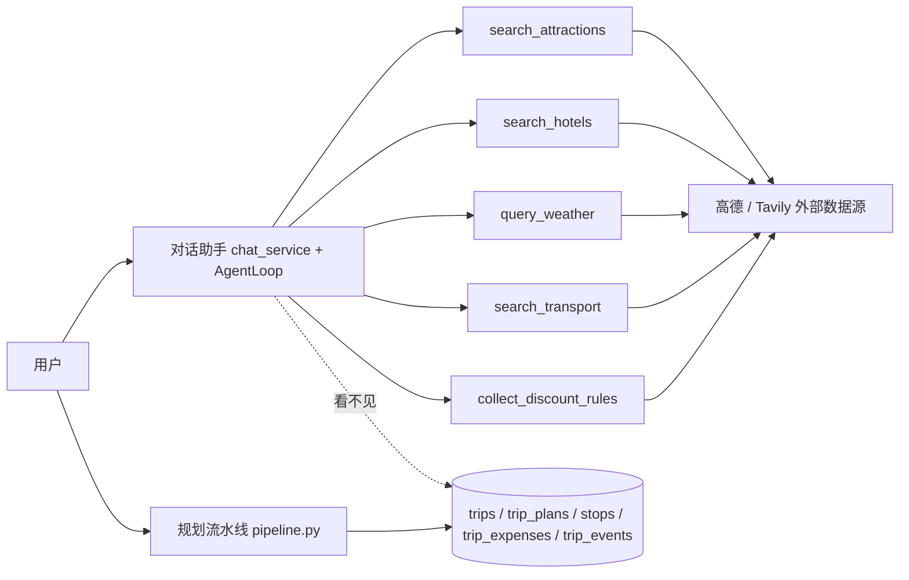

# AI 助手 × 行程数据流打通设计（方案 1 + 2）

> 状态：设计已确认，待实施（暂不动代码）
> 日期：2026-10-28
> 相关文档：`docs/agent-runtime-design.md`（AgentLoop）、`docs/architecture-upgrade-2026-10-28.md`（C+A 架构升级）
> 事实来源：本次会话代码实测（`chat_service.py` / `runtime.py` / `tools.py` / `revise_service.py` / `map_edit_service.py` / `profile_service.py` / `models/*` / `schemas/chat.py`）

---

## 一、背景与目标

### 现状缺口

对话式行程助手（B 期 chat）现在是一个**通用导游**，不是用户的**旅行管家**：

- 工具集（`chat_service._chat_tools`）只有 6 个外部数据源工具：`search_attractions` / `search_hotels` / `search_foods` / `query_weather` / `search_transport` / `collect_discount_rules`
- **对话上下文里没有任何用户行程数据**——用户问「我的杭州行程第 2 天住哪」「把灵隐寺移到第 3 天」，助手既读不到也改不了
- 用户对行程的修改（地图拖拽、AI 修订、费用记录、打卡）也完全不会回流到对话



### 目标

1. **方案 1（读）**：对话助手能感知用户自己的行程（列表、详情、站点），回答基于真实数据、不编造
2. **方案 2（写）**：对话中提出的行程修改经 **HITL 两阶段确认** 后，走与地图拖拽/AI 修订**同一条原子 diff 管线**真实落库
3. 全部改动对齐既有架构纪律：owner 隔离、最小权限、故障兜底、可观测 trace、eval 先行

---

## 二、关键基座（设计直接复用的现成能力）

| 基座 | 位置 | 用处 |
|---|---|---|
| `ChatSession.context_json` 预留 `trip_id` 契约 | `models/chat.py:35-36`、`schemas/chat.py:13` | 会话绑定行程，零迁移 |
| `AgentTool.retryable` 契约（注释明确「有副作用的工具必须置 False」） | `runtime.py:83` | 写工具防重试副作用 |
| `AgentTool.parameters` pydantic 参数模型 → JSON schema | `runtime.py:95-102` | 工具参数强校验，注入内容无法产生非法 JSON |
| `revise_service._apply_diff` 原子 diff 管线（预检→应用，全通过才写） | `revise_service.py:390-449` | LLM 产出的 diff 复用同一套落库逻辑 |
| `_enforce_driving_constraints` + `check_plan_driving_async` DrivingGate | `revise_service.py` / `map_edit_service.py:139` | 写前门控：超距/超时拒绝 |
| `_recompute_budget` + `_plan_snapshot` 快照回填 | `revise_service.py:327` | 修改后预算重算 + TripPlan 快照保持新鲜 |
| `trip_service._load_trip(owner=...)` owner 隔离 | `trip_service.py:62-67` | 行程工具只读本人行程 |
| `TripEvent` append-only 事件流 | `models/trip.py:251-267` | 对话修改留痕 |
| `profile_service._record_behavior`（fire-and-forget） | `profile_service.py:58`、`trip_service.py:20-52` | 对话修改反哺行为记忆 |
| `AgentLoop.transform_context` 钩子（上下文预算预留） | `runtime.py:161,247-249` | 方案 3 上下文注入 |
| 可观测性 trace | `app/core/tracing.py`、`LOG_FORMAT=json` | 每次对话工具调用带 trace_id 记录 |

---

## 三、方案 1：只读打通 — 行程感知工具

### 3.1 新增 `app/agent/trip_tools.py`

三个只读 `AgentTool`（pydantic 参数模型声明，参数经 `AgentTool.parameters` 强校验）：

```python
# 伪代码：结构示意（实施时按 repo 惯例补全）
class TripToolParams(BaseModel):
    trip_id: str | None = None        # 缺省 = 使用会话绑定的行程

get_my_trips = AgentTool(name="get_my_trips", ...)          # 我的行程列表（标题/目的地/日期/状态）
get_trip_overview = AgentTool(name="get_trip_overview", ...) # 单个行程摘要（含 days/stops + 预算 + 最新的 AI 方案索引）
```

**不设 `get_trip_detail(全量 plan JSON)` 工具**——`TripPlan.plan_data` 动辄 5-10k tokens，整段塞进对话上下文会把预算打爆。工具返回**摘要契约**，只给定位所需的字段：

```jsonc
// get_trip_overview 返回（示例，token 预算 ≈ 400-900）
{
  "trip_id": "uuid",
  "title": "杭州 3 天",
  "destination": "杭州",
  "departure": "上海",
  "start_date": "2026-11-01",
  "end_date": "2026-11-03",
  "status": "draft",
  "updated_at": "2026-10-28T10:00:00+08:00",   // 写操作并发校验基线（方案 2）
  "budget": { "total_estimated": 3200.0, "by_type": { "attraction": 300.0, "food": 900.0, "hotel": 2000.0 } },
  "days": [
    {
      "day_number": 1,
      "date": "2026-11-01",
      "theme": "西湖环湖",
      "stops": [
        { "name": "灵隐寺", "type": "attraction", "lat": 30.24, "lng": 120.10,
          "estimated_cost": 75.0, "duration_minutes": 180 },
        { "name": "杭州西湖国宾馆", "type": "hotel", "lat": 30.23, "lng": 120.13,
          "estimated_cost": 1200.0, "duration_minutes": null }
      ]
    }
  ],
  "stop_count": 12,          // 截断计数：站点过多时明确告知
  "truncated": false,        // true = 仅返回前 N 个站点
  "has_plan_snapshot": true  // false = 无 AI 方案快照时回退到 days/stops 原始数据
}
```

**数据来源优先级**（与 skill 里 `checkin-hotel-bug` 教训一致：**消费方读对了字段**）：
1. `TripPlan.plan_data`（最新，`plans[0]`，按 `created_at` 倒序）中的 `days[].stops[]`（已安排站点，`type=="hotel"` 是已安排酒店）
2. 快照缺失 → ORM `trip.days[].stops[]` 原始数据组装
3. 都没有 → 明确返回「该行程暂无站点数据」，**绝不返回 `plan.hotels` 候选池冒充已安排住宿**

### 3.2 会话绑定行程

- 创建会话时 `context: {"trip_id": "..."}`——`ChatSessionCreate.context` 已支持（`schemas/chat.py:13`），**后端新增校验**：trip_id 非空时必须属于当前用户（走 `trip_service._load_trip(owner=user.id)`），不通过返回 4xx，不静默解绑
- `send_message` 执行前从 `session.context_json` 取 trip_id，闭包进工具 execute（**工具不信任 LLM 传入的 trip_id，优先用会话绑定值**；LLM 传了别的 trip_id → 也要做 owner 校验）

### 3.3 装配与系统提示词

- `_chat_tools()` 增加两个工具（全部工具仍是只读；`retryable=True` 安全）
- `_SYSTEM_PROMPT` 增加一条规则：涉及用户行程的问题必须先调用行程工具；行程数据与搜索数据冲突时**以行程工具数据为准**并说明差异

### 3.4 故障模式与兜底

| 故障 | 检测 | 处理 |
|---|---|---|
| 行程不存在 / 非本人 | owner 查询返回 None | 工具返回结构化错误；LLM 如实告知「行程不存在或无权限」，不编造 |
| 行程无 AI 方案快照 | `has_plan_snapshot=false` | 回退 ORM 原始数据（见 3.1） |
| 站点过多超出预算 | 计数截断 | `truncated=true` + `stop_count`，prompt 规则要求 LLM 说明「仅显示前 N 个」 |
| DB / 工具异常 | execute 抛错 | `retryable=True` 重试 1 次 → 仍失败返回友好错误喂回 LLM（现有 `_execute_tool_with_retry` 行为） |
| 会话未绑定行程但用户问「我的行程」 | get_my_trips 返回空 | LLM 引导用户先打开/绑定行程（前端入口见 3.5） |

### 3.5 前端最小改动

- 行程详情页/列表页增加「问 AI」入口：携带 `trip_id` 创建/复用一个绑定的会话（复用现有 chat 路由）
- 聊天面板显示当前绑定行程 chip（trip 标题 + 退出按钮）

### 3.6 测试计划（eval 先行）

- `backend/tests/test_chat_trip_tools.py`（≥20 用例）：
  - 功能性：owner 隔离（他人行程 → 错误）、快照优先、快照缺失回退、截断、绑定会话注入
  - Schema：工具输出符合摘要契约（pydantic 校验）
  - 故障：DB 异常 → 重试 → 友好错误；行程不存在
  - **LLM 路径必须 mock**（`monkeypatch.setattr("app.agent.providers.invoke_with_resilience", _boom)`，见 skill 测试纪律）
- 端到端：绑定会话问「第 2 天住在哪」→ LLM 调用工具返回真实 stops 中的 hotel（回归测试钉住「候选池 ≠ 已安排酒店」教训）

---

## 四、方案 2：读写打通 — 对话即编辑

### 4.1 `edit_trip` 工具契约（两阶段 HITL）

```jsonc
// 输入（pydantic 强校验）
{
  "trip_id": "uuid",
  "confirm": false,            // false=仅预览；true=应用
  "expected_updated_at": "2026-10-28T10:00:00+08:00",  // 预览时返回；应用时校验并发
  "summary": "把灵隐寺移到第3天",
  "actions": [
    { "op": "replace", "day_number": 1, "target": { "name": "灵隐寺" },
      "fields": { "day_number": 3 } },              // 注意：跨天移动 = replace day_number
    { "op": "add", "day_number": 3, "index": 2,
      "fields": { "name": "龙井村", "type": "attraction",
                  "lat": 30.19, "lng": 120.09, "estimated_cost": 0.0,
                  "duration_minutes": 120, "description": "茶文化体验" } },
    { "op": "remove", "day_number": 2, "target": { "name": "某网红餐厅" } },
    { "op": "reorder", "day_number": 1, "target": { "name": "断桥残雪" }, "index": 2 }
  ]
}

// 输出（confirm=false 时）
{
  "applied": false,
  "status": "preview",
  "driving": { "ok": true, "issues": [] },          // DrivingGate 预检结果
  "changed": [ { "op": "replace", "op_label": "调整", "day_number": 3,
                 "target_name": "灵隐寺", "fields": { "day_number": 3 } } ],
  "budget_delta": { "total_estimated": 3200.0, ... },  // 预览预算变化
  "expected_updated_at": "...",
  "next_step": "回复确认后我已应用此修改"              // prompt 规则要求 LLM 转述
}

// 输出（confirm=true 且成功）
{
  "applied": true,
  "status": "applied",
  "applied_at": "2026-10-28T10:05:00+08:00",
  "new_updated_at": "...",                          // 新基线，供后续再次修改
  "plan_version": 7                                 // TripPlan 快照版本（可观测）
}

// 输出（DrivingGate 拒绝）
{
  "applied": false, "status": "rejected",
  "driving": { "ok": false, "issues": [ { "day": 1, "from": "灵隐寺", "to": "龙井村",
      "reason": "驾车时间超过 90 分钟" } ] },
  "hint": "请缩小修改范围或调整站点顺序后重试"
}
```

### 4.2 执行管线（复用，新写 ≤50 行装配）

```
edit_trip(confirm=false) ──► owner 校验 ──► _find_day/_find_stop 预检
                                   │（失败 → 结构化错误喂回 LLM 重发）
                                   ▼
                          _apply_diff(diff)   ← 原子预检（任一动作不合法整体拒绝）
                                   │
                                   ▼
                          _enforce_driving_constraints(trip)   ← DrivingGate
                                   │ 拒绝 → 返回 issues，不落库
                                   ▼
                          预算重算 _recompute_budget → flush（不 commit）
                                   │
                                   ▼
                          _plan_snapshot → 回填最新 TripPlan 快照
                                   │
                                   ▼
                          TripEvent(event_type="chat_edit") 留痕
                                   ▼
                          commit → 返回新基线
```

- **`confirm=false` 预览不落库**：只跑预检 + DrivingGate + 预算试算（试算可基于内存副本或只对比增量）；返回预览卡片数据
- **`confirm=true` 才走完整管线**；`retryable=False`（有副作用，重试会重复应用）
- **幂等/防并发**：应用前校验 `expected_updated_at == trip.updated_at`；不匹配 → 拒绝 + 返回最新摘要让用户重新确认（防止对话期间地图拖拽/AI 修订造成的计划漂移）

### 4.3 HITL 门控设计（对齐升级校准框架）

| 要素 | 设计 |
|---|---|
| 何时需要确认 | 所有写操作（`add/remove/replace/reorder` 任一）；**不可逆性 + 修改既有数据** → 阻塞式确认 |
| 确认界面 | 前端渲染 preview 为卡片：动作列表（op_label + 目标 + 改了什么）、DrivingGate 结果、预算变化；一键「确认应用 / 取消」 |
| 超时行为 | 会话内确认不跨请求持久（预览返回后用户下一条消息就是确认）；**不设静默超时应用** |
| 升级标准 | DrivingGate 拒绝 → 不升级人工，LLM 依据 issues 缩小范围重发（最多 2 次）；仍失败 → 明确告知用户「修改被拒绝：原因」 |
| 过度升级防护 | 预览不打断用户（对话内自然确认），不弹模态审批流 |

### 4.4 行为记忆反哺

对话中「删掉 X」「缩短 Y」「添加 Z」应用成功后，调用 `profile_service._record_behavior`（fire-and-forget，`trip_service._record_behavior_safely` 同款包装：写记忆失败仅回滚记忆，不阻断主流程）。信号 `kind="chat_edit"`，供方案 3 的画像注入使用。

### 4.5 故障模式与兜底

| 故障 | 检测 | 处理 |
|---|---|---|
| DrivingGate 拒绝 | `driving.ok=false` | LLM 依据 issues 重生成更小 diff，最多重试 2 次；仍失败 → 如实告知拒绝原因 |
| diff 目标定位失败 | `_find_stop` 返回 None → `revise_target_not_found` | 错误喂回 LLM，用正确 day+name 重发；LLM 幻觉站点名**不会产生脏数据**（预检整体拒绝） |
| 并发修改冲突 | `expected_updated_at` 不匹配 | 拒绝 + 返回最新摘要提示重新确认 |
| 应用中途异常 | `_apply_diff` 抛 AppError | 事务不 commit → 回滚；返回错误喂回 LLM |
| 用户确认超时/取消 | 下一条消息不是确认 | 无残留状态（预览不落库），LLM 询问是否重来 |
| LLM 编造确认结果 | 应用结果以工具返回值 `applied=true` 为准 | 前端卡片只认工具输出；assistant 文本不承载状态 |

### 4.6 前端确认卡片交互

- WS 流式事件：`tool_execution_start(tool_name=edit_trip)` 时前端展示「正在修改行程…」
- `tool_end` 时若结果为 preview → 渲染确认卡片 + 「确认应用」按钮（`data-hermes-send` 式交互：按钮点击 = 发送「确认修改」消息，进入 confirm=true 轮）
- 应用成功 → 卡片转「已应用」+ 触发行程刷新（复用现有 trip 事件/WS 刷新）

### 4.7 测试计划

- `backend/tests/test_chat_edit_trip.py`（≥20 用例）：
  - 预检拒绝：不存在站点、非法 op、非法 index
  - DrivingGate：超距/超时 → rejected 输出契约
  - confirm=true 应用成功 → stops 变更 + TripPlan 快照回填 + TripEvent 留痕
  - 并发：expected_updated_at 过期 → 拒绝
  - 幂等：`retryable=False` 断言（读工具清单确认不被 AgentLoop 重试）
  - mock LLM 路径（技能纪律：不 mock 会真调 provider）
- 回归：地图拖拽（map_edit）、AI 修订（revise）既有测试必须全绿（同一条 diff 管线不能因装配改动被破坏）

---

## 五、方案 3（双向感知——已实施 2026-10-28）

**行程事件订阅 + 上下文注入（双向感知）**：绑定行程的会话每次发送消息时，通过 `AgentLoop.transform_context` 钩子（runtime.py 已预留）注入「行程摘要 + 最近 TripEvent 摘要 + 画像摘要」，每轮快照，让模型始终看到最新状态。

**实现**（`backend/app/services/chat_trip_context.py`）：
- `build_trip_context(db, user_id, trip_id)`：无绑定行程 → 空串零注入；有行程 → 元信息 + 最近事件 + 画像
- 事件类型白名单 `revise/chat_edit/check/skip/delay/edit`（评论/投票等噪音不注入）
- 事件风暴：最多 8 条 + 单条 ≤120 字符 + 超量折叠提示「另有 N 条未展开」（**不静默丢弃**）
- 画像复用 `profile_to_context`（规划侧同一来源）
- 注入块带固定标记 + `快照于 <时间>`，让模型区分实时快照与历史消息
- `make_transform_context(db, ...)` 返回钩子，注入失败原样返回消息（零侵入）

风险与治理落地：
- 事件风暴 → 摘要窗口 + 类型白名单（已实现）
- 循环注入（事件→上下文→对话→再写事件）→ chat_edit 事件由方案 2 记录，注入只读 TripEvent 不回写，**无循环**
- 上下文膨胀 → `build_trip_context` 带 max_tokens 预算（默认 600），粗估超限截断为「最近部分」（行程事件在后保关键，不静默丢）

**依赖方案 1+2 落地后的实际使用数据再启动**——本方案采用「轻量版」（每轮注入，非事件驱动推送），已随 1+2 一并落地；后续可视使用数据升级为「事件驱动主动提醒」。

---

## 六、决策矩阵与推荐路线

| 维度 | 方案 1 只读 | 方案 2 读写 | 方案 3 全链路 |
|---|---|---|---|
| 打通度 | 读 ✅ | 读+写 ✅ | 双向感知 |
| 风险 | 低（纯读 + 既有 owner 隔离） | 中（写需 HITL 治理） | 中高（上下文预算） |
| 后端成本 | ~1 天 | ~2 天 | ~1.5 天 |
| 前端成本 | ~0.5 天 | ~1 天（确认卡片） | ~0.5 天 |
| 返工风险 | 低（方案 2 地基） | 低 | 依赖 1+2 |

**推荐路线：方案 1 → 方案 2（主线目标）→ 方案 3 视使用数据再定。** 1→2 为纯增量：同一套摘要契约、owner 隔离、会话绑定，不推翻重来。

---

## 七、风险与治理清单（对齐架构评审）

- [ ] **最小权限**：行程工具只读/写当前 owner 的行程；scope 不跨工具传递；`edit_trip` 仅暴露 diff 级操作（不能直接改标题/删除行程本身——这类高危操作留给专属端点）
- [ ] **Prompt injection 防线**：对话输入是用户文本（内部用户），行程数据来自本系统 DB（可信）；工具参数 pydantic 强校验——被注入的指令产生不了合法 JSON；输出经摘要契约 schema 校验
- [ ] **上下文预算**：工具返回摘要而非全量 plan JSON；截断带 `truncated` 标记，**绝不静默截断必需字段**
- [ ] **可观测性**：每次工具调用由 AgentLoop trace 记录（tool/args/observation/is_error）；写操作 + TripEvent 双留痕；失败可回溯到具体工具
- [ ] **故障兜底**：读路径 重试→友好错误；写路径 预检/DrivingGate 拒绝→反馈重发→如实告知；系统始终产出*某种东西*（结构化拒绝 ≠ 静默失败）
- [ ] **eval 先行**：每个新工具 ≥20 用例 + mock LLM；全流水线回归（existing 523 tests 全绿 + 前端 build）

---

## 八、实施步骤（阶段拆分，待启动）

### P0 方案 1（只读）
1. `app/agent/trip_tools.py`：`get_my_trips` / `get_trip_overview` + 摘要契约 + owner 隔离
2. `chat_service`：`_chat_tools()` 装配 + `_SYSTEM_PROMPT` 行程规则
3. 会话绑定：`POST /chat/sessions` 校验 `context.trip_id` owner
4. 前端：行程页「问 AI」入口 + 绑定 chip
5. 测试：`test_chat_trip_tools.py` ≥20 用例 + 全套回归

### P1 方案 2（读写）
1. `app/agent/trip_edit_tool.py`：`edit_trip` 两阶段 + diff 契约 + DrivingGate 集成
2. 装配进 `_chat_tools()`（`retryable=False`）
3. 前端确认卡片（tool_end preview → 确认按钮 → confirm 轮）
4. `TripEvent` 留痕 + 行为记忆反哺
5. 测试：`test_chat_edit_trip.py` ≥20 用例 + 全套回归 + 前端 build

### P2（延后）方案 3
按第五节评估启动。